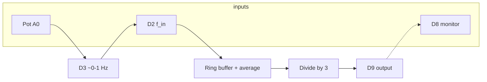

# In-depth explanation: `ArduinoNano_Pin7_to_Pin5.ino`

This document describes **what the sketch does**, **the signal-processing approach**, and **why** specific techniques (ring buffer, hysteresis, Timer1 vs software, stall logic, D8 handling) were used.

---

## 1. Purpose and signal flow

**Goal:** Measure the frequency of a signal on **D2** (rising edges), and produce a **square wave on D9** whose frequency is **one third** of that measured input: \(f_{\mathrm{out}} = f_{\mathrm{in}} / 3\).

**Test setup used in development:**

- **D3** outputs a variable square wave (**0–1 Hz**, set by a potentiometer on **A0**).
- **D3** is wired to **D2**, so the Nano measures its own generator (or you can feed any external TTL-like signal into **D2**).
- **D8** optionally monitors **D9** (wire **D9 → D8** for a closed-loop check on Serial).

**Decoupling:** Input edges only **push samples** into a buffer. The **output** is updated from the **running average** on every `loop()` iteration, **not** in the D2 interrupt path. That avoids output phase being tied to random edge alignment and keeps the design easy to reason about.

---

## 2. Pins and constants

| Pin | Role |
|-----|------|
| **A0** | ADC: pot maps to **D3** frequency **0–1 Hz** (see §3). |
| **D3** | **Output:** square wave generator (optional test source). |
| **D2** | **Input:** rising-edge period measurement. |
| **D8** | **Input:** optional monitor of **D9** (last rising-to-rising interval for `d8Freq_Hz`). |
| **D9** | **Output:** **Timer1 OC1A** (hardware) or **bit-banged** square wave (software fallback). |

Key constants:

- **`OUT_FREQ_DIV = 3`** — output frequency is **input / 3**.
- **`PERIOD_BUF_LEN = 6`** — rolling buffer of the last **6** measured periods (balance: **stability** vs **responsiveness**; shorter than 10 helps at **very low** \(f_{\mathrm{in}}\)).
- **`SERIAL_LOG_MS = 250`** — Serial line rate.

---

## 3. D3 generator (pot on A0 → 0–1 Hz)

**Idea:** Map ADC reading to **frequency in millihertz**, then convert to **half-period in microseconds** for a **toggle**-based square wave.

- **`D3_ADC_FULL = 675`** assumes **~0–3.3 V** on the wiper with **default 5 V AREF** (≈675 counts). Use **`1023`** if the pot spans **0–5 V** to **1 Hz** full scale.

**Frequency:**

\[
f_{\mathrm{mHz}} = \mathrm{clamp}\left(\frac{\mathrm{adc} \cdot 1000}{D3\_ADC\_FULL},\, 0,\, 1000\right)
\]

(1000 mHz = 1 Hz.)

**Half-period** (toggle every half cycle of a square wave):

\[
T_{\mathrm{half}} = \frac{10^6}{2 f} = \frac{5 \cdot 10^8}{f_{\mathrm{mHz}}} \ \mu\mathrm{s}
\]

Implemented as integer: `500000000UL / f_mHz`.

**Timing:** `micros()`-based; `nextD3ToggleUs` is advanced by `d3HalfPeriodUs` each toggle. When the pot changes frequency, `nextD3ToggleUs` is reset to avoid a huge phase jump. Catch-up is **capped** (e.g. 24 toggles per `loop`) so a long stall cannot freeze the CPU for seconds.

**adc = 0:** Frequency 0 → D3 held **LOW** (no oscillation).

---

## 4. Measuring \(f_{\mathrm{in}}\) on D2: ring buffer and average

**Rising-edge detection:** Compare current digital read to `prevHighIn`; a transition **low → high** is a rising edge.

**Period:** Time since the **previous** rising edge (`nowUs - lastRiseUs`), in microseconds.

**Buffer:** Fixed array `periodBuf[6]`, with:

- **`bufCount`** — how many valid samples (ramps to 6).
- **`bufNext`** — index of the **next** write (oldest sample’s index when the buffer is **full**).

When **full**, the buffer is a **ring**: the oldest period is overwritten each time. **`ringPeriodSum`** sums either all entries from `0..count-1` (partial fill) or **`bufNext .. bufNext+5` modulo 6** (full ring) so the sum is always over the **last six** periods.

**Average:**

\[
T_{\mathrm{avg}} = \frac{1}{N}\sum \text{periods}
\]

`averageD2PeriodUs()` returns **`0`** if there is **no** data yet.

**Why average?** A single period is noisy; the rolling mean smooths jitter from the pot, breadboard, and sampling.

---

## 5. Dividing frequency by 3: math and implementation

**Target:**

\[
f_{\mathrm{out}} = \frac{f_{\mathrm{in}}}{3} \quad\Rightarrow\quad T_{\mathrm{out}} = 3\,T_{\mathrm{in}}
\]

For a **square wave** on D9, the **toggle** happens every **half** of the output period:

\[
T_{\mathrm{half,out}} = \frac{T_{\mathrm{out}}}{2} = \frac{3\,T_{\mathrm{in}}}{2}
\]

**Odd divisor:** You cannot use integer `OUT_FREQ_DIV/2` only (that would give **1** for ÷3). The code uses **64-bit** arithmetic:

\[
\text{OCR}+1 = \frac{F_{\mathrm{CPU}} \cdot T_{\mathrm{in}} \cdot \mathrm{OUT\_FREQ\_DIV}}{2 \cdot 10^6 \cdot \mathrm{prescaler}}
\]

i.e. `ocr1 = F_CPU * avgPeriodUs * OUT_FREQ_DIV / (2e6 * ps)` with `uint64_t` to avoid overflow.

**Timer1 (CTC, toggle OC1A on compare):** For prescaler `ps` and `OCR1A = ocr`, half-period in timer ticks is `ocr+1`, and the **toggle frequency** is:

\[
f_{\mathrm{toggle}} = \frac{F_{\mathrm{CPU}}}{2 \cdot \mathrm{ps} \cdot (\mathrm{ocr}+1)}
\]

which equals \(f_{\mathrm{in}}/3\) when `ocr1` is computed as above.

**Prescaler search:** Try **1, 8, 64, 256, 1024**; pick the first where **`1 ≤ ocr1 ≤ 65536`** (16-bit timer).

**Software fallback:** If **no** prescaler yields a valid OCR, Timer1 is turned off and D9 is toggled in software: **`stepUs = outputHalfPeriodUs(lastAvgPeriodUs)`** = \((T_{\mathrm{in}} \cdot 3 + 1)/2\) rounded. Same catch-up cap as D3 to avoid blocking `loop()`.

---

## 6. When to update the output: hysteresis (`shouldApplyAvgPeriod`)

If **`applyOutputFromAvgPeriodUs`** ran on **every** tiny change in the rolling average, two problems appear:

1. **Timer reprogrammed** constantly → phase jitter and unnecessary work.
2. **D8** (if cleared on every apply) could **never** accumulate two rising edges at low \(f_{\mathrm{out}}\).

So the code only applies when the **average period** moved by more than a **threshold**:

\[
\text{thresh} = \frac{\min(\mathrm{avg},\mathrm{lastApplied})}{256} + \frac{\min}{512} + 50\ \mu\mathrm{s}
\]

Roughly **~0.4% + ~0.2% + 50 µs**, scaling with period so **low frequencies** are not over-sensitive to jitter.

Special cases: **`avg == 0`** → apply only to **stop** output; first apply after boot; **`0xFFFFFFFF`** sentinel for “never applied”.

---

## 7. `applyOutputFromAvgPeriodUs`

- Updates **`lastAvgPeriodUs`** and **`lastAppliedAvgPeriodUs`**.
- **`avgPeriodUs == 0`:** Stall / no signal → turn off Timer1, D9 **LOW**, clear **D8** Serial state (so you do not show a stale `d8Freq_Hz` with no output).
- **Nonzero:** Try Timer1 prescalers; else enable **software** output.
- **D8 is not cleared** on every successful retune (only on stop), so at **low** \(f_{\mathrm{out}}\) the monitor can still complete a **full** interval between D8 edges.

---

## 8. Stall detection (no input)

If **no D2 rising edge** arrives for too long, the sketch assumes the signal stopped: clear buffer, reset D2 state, **`apply(0)`**.

**Timeout:**

\[
T_{\mathrm{stall}} = \max(1\,\mathrm{s},\, 3 \cdot T_{\mathrm{avg}})
\]

when **`averageD2PeriodUs() > 0`**, using the **live** buffer average (not only “last applied”).

**Critical edge case — only one edge so far:** Before the **second** edge, there is **no** period in the buffer (`bufCount == 0`, `avg == 0`). A naive **1 s** timeout would **fire** for \(f_{\mathrm{in}} < 1\) Hz **before** the second edge arrives, clearing state forever. The code uses **`NO_INPUT_WAIT_FIRST_PERIOD_US` (120 s)** in that state so **very slow** signals can still register a first interval.

---

## 9. D8 monitoring and Serial output

**Measurement:** On each **D8** rising edge, store **`lastD8PeriodUs = now - lastRiseMonUs`**.

**`avgFreq_Hz` / `outFreq_Hz`:** From **`ap2`** = current buffer average: \(f_{\mathrm{in}} = 10^6 / T_{\mathrm{avg}}\), \(f_{\mathrm{out,serial}} = f_{\mathrm{in}}/3\).

**`hwOutFreq_Hz`:** From **Timer1** registers (`timer1HwToggleHz`) when not in software mode — **ground truth** for what the MCU is actually generating.

**Hiding `d8Freq_Hz` when “stale” in time:** If the time since the **last** D8 rise exceeds **`3 × refPeriod + 500 ms`**, where **`refPeriod`** is the **maximum** of:

- last measured D8 period,
- **`ap2 × OUT_FREQ_DIV`** (expected output period from buffer),
- **`10^6 / hwHz`** (timer period),

then the line is suppressed (signal lost or D8 disconnected).

**Hiding `d8Freq_Hz` when “stale” vs reality:** If **`d8Hz`** differs from **`hwHz`** (or from buffer-based \(f_{\mathrm{out}}\) in software mode) by **more than 10%**, suppress **`d8Freq_Hz`** until the **next** full interval matches — avoids showing **0.333 Hz** on D8 while **hw** already shows **0.300 Hz** after a pot change.

**`logUs = micros()`** at log time for accurate **`sinceRise`**.

---

## 10. Pull-ups and startup

**`disableInternalPullupsAllPins()`** sets pins **0–19** to **`INPUT`** (no `INPUT_PULLUP`) so **D2/D8** are high-impedance unless the external circuit drives them — avoids masking a weak signal with the internal **~30 kΩ** pull-up.

**`setup`** then reconfigures **D3** output, **D2/D8** input, **D9** output, Serial, and initial edge detector state.

---

## 11. Design tradeoffs (summary)

| Topic | Choice | Rationale |
|--------|--------|-----------|
| Average | Rolling **6** samples | Faster convergence at low \(f_{\mathrm{in}}\) than 10; still filters noise. |
| Output update | **Hysteresis** on \(T_{\mathrm{avg}}\) | Avoids retuning every edge; stable D9 and D8 at low frequency. |
| D9 | **Timer1** when possible | Accurate, low CPU; **software** only when OCR does not fit. |
| ÷3 | **\(F\_\mathrm{CPU} \cdot T\_\mathrm{in} \cdot 3\) / (2×10⁶×ps)** | Correct for **odd** divisor; avoids `OUT/2` integer bug. |
| Stall | **3×\(T_{\mathrm{avg}}\)** + **special case** for first period | Prevents false stall on slow signals; still detects real loss. |
| D8 Serial | **Time** + **10% agreement** with ref | Hides garbage when interval lags a retuned timer. |

---

## 12. Float vs integer

Core **timing** and **OCR** math use **integers** (`uint32_t` / `uint64_t`) for determinism on AVR. **Serial** uses **float** only for **Hz** display and comparisons (`hwHz`, `d8Hz`, `refOutHz`).

---

This file documents the **current** sketch behavior. Older notes (e.g. `EXPLANATION-output-half-frequency.md`) may refer to **÷2** or half-frequency experiments and might not match **`OUT_FREQ_DIV = 3`** and the D3/A0 setup.
